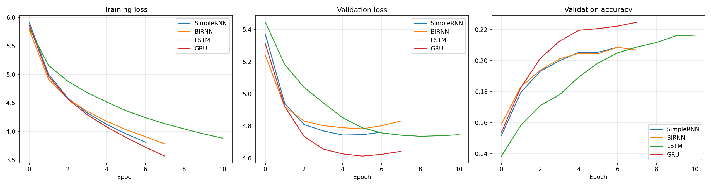
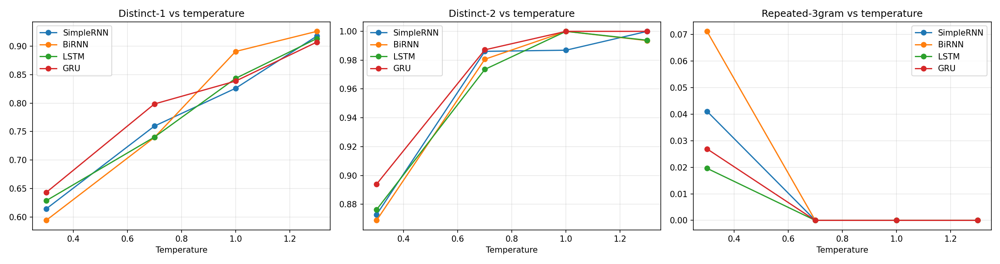

# Autoregressive Text Generation with SimpleRNN, BiRNN, LSTM and GRU

Foundations of Generative AI (ICT4403) - Assignment 2

**Author:** Varaang Tiwari | **Reg. No.:** 230953378 | School of Computer Engineering, Manipal Institute of Technology

## 1. Problem statement and objective
Build a word-level autoregressive language model that predicts the next word and generates text one word at a time. Four recurrent architectures (SimpleRNN, Bidirectional RNN, LSTM, GRU) are trained under identical conditions and compared on loss, perplexity, accuracy, training time and generated-text quality. The effect of sampling temperature on coherence, diversity and repetition is then analysed, and the most effective model is identified.

## 2. Dataset
- **Name:** *Grimms' Fairy Tales* by Jacob and Wilhelm Grimm, English translation (Project Gutenberg eBook #2591)
- **Source:** https://www.gutenberg.org/ebooks/2591 (plain text: https://www.gutenberg.org/cache/epub/2591/pg2591.txt)
- **Characteristics:** 530,055 characters, 119,182 tokens (words + punctuation), 5,193 unique tokens. About 60 folk tales with a simple narrative voice, heavy dialogue, repeated story formulas ("once upon a time", "the king said") and recurring characters (king, queen, old woman, wolf). The most frequent tokens are `,` `the` `and` `.` `to`.
- **Preprocessing:** remove Gutenberg header/footer, normalise quotes, lowercase, remove underscores, tokenise into words and punctuation marks (`. , ! ? ; :`), keep the 5,000 most frequent tokens and map the rest to `<OOV>` (OOV rate 0.16%).
- **Input-target pairs:** sliding window of 20 tokens (stride 1) as input, the next token as target, i.e. the model learns P(w_t | w_{t-20}, ..., w_{t-1}). A chronological 80/10/10 split of the token stream is made *before* windowing to avoid leakage between splits.
  - Train: 95,325 sequences | Validation: 11,898 | Test: 11,899

## 3. Models
All models: `Embedding(128) -> recurrent layer (256 units) -> Dropout(0.3) -> Dense(5000, softmax)`.

| Model | Recurrent layer |
|---|---|
| SimpleRNN | `SimpleRNN(256)` |
| BiRNN | `Bidirectional(SimpleRNN(128))` (256-d output, forward + backward over the 20-word context) |
| LSTM | `LSTM(256)` |
| GRU | `GRU(256)` |

Shared settings: Adam (lr 1e-3, clipnorm 1.0), batch size 256, max 20 epochs, early stopping on validation loss (patience 2, best weights restored), sparse categorical cross-entropy, random seed 42.

## 4. Execution steps and dependencies
```bash
pip install tensorflow numpy pandas matplotlib
jupyter notebook autoregressive_text_generation.ipynb      # or upload to Google Colab (GPU runtime)
```
Run all cells in order. The notebook downloads the dataset from Project Gutenberg, trains the four models, and writes all tables, plots and generated samples to `results/`.

## 5. Results (test set)

| Model | Params | Epochs run | Train time (s) | Test loss | Perplexity | Top-1 acc | Top-5 acc |
|---|---|---|---|---|---|---|---|
| SimpleRNN | 2,023,560 | 7 | **24.2** | 4.8588 | 128.87 | 19.15% | 41.41% |
| BiRNN | 1,990,792 | 8 | 30.7 | 4.9058 | 135.07 | 19.46% | 41.55% |
| LSTM | 2,319,240 | 11 | 53.0 | 4.8644 | 129.59 | 20.04% | 42.27% |
| **GRU** | 2,221,448 | 8 | 36.5 | **4.7365** | **114.03** | **21.14%** | **43.09%** |

Plots: `training_curves.png`, `perplexity.png`, `train_time.png`, `temperature_analysis.png`.



## 6. Model comparison and evaluation

**Quantitative.**
- **GRU is best on every accuracy-type metric:** lowest test loss (4.74), lowest perplexity (114.0), and highest top-1 (21.1%) and top-5 (43.1%) accuracy. Its perplexity is about 11% lower than SimpleRNN's and LSTM's.
- **SimpleRNN is the fastest** (24.2 s) and, surprisingly, competitive with LSTM on perplexity (128.9 vs 129.6). On a 20-word context the vanishing-gradient problem is mild, so the gap to gated cells is small in loss terms.
- **LSTM** reaches slightly better accuracy than SimpleRNN (20.0% vs 19.2%) but takes about 2x longer (53.0 s, 11 epochs), because it learns more slowly (see training curves) and has the most parameters.
- **BiRNN has the worst perplexity** (135.1) although its top-1 accuracy is marginally above SimpleRNN's. Its validation loss started rising soonest, i.e. it became over-confident on wrong predictions. Looking backwards over the context gives it little extra, since the target word always lies *after* the window; and it is still a plain RNN with no gating.
- **Overfitting:** with only ~95k training windows and ~2M parameters, training loss keeps falling while validation loss flattens after epochs 4-6 for SimpleRNN, BiRNN and GRU. Early stopping with best-weight restoration controls this.
- Perplexities of 114-135 over a 5,000-word vocabulary are far better than uniform guessing (5,000) but high in absolute terms, which is expected for a small, narrative corpus where many next words are plausible.

**Qualitative** (see `generated_samples.md`).
- **SimpleRNN / BiRNN:** produce locally grammatical clauses but drift quickly; BiRNN at low temperature collapses into "and the king was ... and the king was ..." loops.
- **LSTM:** keeps character continuity well (e.g. "the soldier", "the king") and produces fairy-tale-style narrative, but is also loop-prone at low temperature.
- **GRU:** the most fluent output and the most varied vocabulary at moderate temperature, with typical Grimm phrasing ("the king was forced...", "said the fish, 'you shall give us...'"). Long-range coherence is still limited for all models: sentences are plausible, but there is no real plot, as expected from a 20-word context window.

## 7. Sampling-temperature analysis
Seeds used: (1) "once upon a time there lived a king who had three sons", (2) "the poor little girl went into the forest and", (3) "then the old woman said to the". Each model generated 60 words per seed at T = 0.3, 0.7, 1.0, 1.3. Values are averaged over the 3 seeds.

| Model | T | Distinct-1 | Distinct-2 | Repeated-3gram |
|---|---|---|---|---|
| SimpleRNN | 0.3 | 0.614 | 0.873 | 0.041 |
| SimpleRNN | 0.7 | 0.760 | 0.986 | 0.000 |
| SimpleRNN | 1.0 | 0.826 | 0.987 | 0.000 |
| SimpleRNN | 1.3 | 0.918 | 1.000 | 0.000 |
| BiRNN | 0.3 | 0.594 | 0.869 | 0.071 |
| BiRNN | 0.7 | 0.740 | 0.981 | 0.000 |
| BiRNN | 1.0 | 0.891 | 1.000 | 0.000 |
| BiRNN | 1.3 | 0.926 | 0.994 | 0.000 |
| LSTM | 0.3 | 0.628 | 0.876 | 0.020 |
| LSTM | 0.7 | 0.740 | 0.974 | 0.000 |
| LSTM | 1.0 | 0.843 | 1.000 | 0.000 |
| LSTM | 1.3 | 0.913 | 0.994 | 0.000 |
| GRU | 0.3 | 0.643 | 0.894 | 0.027 |
| GRU | 0.7 | 0.798 | 0.987 | 0.000 |
| GRU | 1.0 | 0.839 | 1.000 | 0.000 |
| GRU | 1.3 | 0.907 | 1.000 | 0.000 |



- **T = 0.3 (conservative):** highest coherence at clause level, but the lowest diversity (Distinct-1 about 0.6) and the only setting with repeated trigrams (up to 7.1% for BiRNN). Output is generic and loops ("and I will be a good ... and I will").
- **T = 0.7 (balanced):** repetition disappears (0 repeated trigrams for all models) while text stays mostly grammatical and story-like. This is the best trade-off.
- **T = 1.0:** diversity rises further but coherence starts to break: odd word combinations and agreement errors appear.
- **T = 1.3 (high):** the highest diversity metrics (Distinct-1 above 0.9) but the text is largely word salad with rare, unrelated words. Note that the diversity metrics *reward* this nonsense, so they must be read together with the qualitative reading, not alone.
- GRU has the highest Distinct-1 at T = 0.7 (0.798), meaning it gives the most varied vocabulary at the temperature where text is still coherent.

## 8. Conclusion
**GRU is the most effective model for autoregressive generation on this dataset.** It has the lowest perplexity (114.0) and highest top-1/top-5 accuracy (21.1% / 43.1%), the most varied yet coherent output at T = 0.7, low repetition at low temperature (2.7% vs 7.1% for BiRNN), and trains in 36.5 s, about 30% faster than LSTM, which gives no accuracy benefit here. SimpleRNN is the cheapest option but weaker, BiRNN is the weakest (the bidirectional context does not help next-word prediction since the target lies outside the window), and LSTM is competitive but slower. A sampling temperature of about 0.7 gives the best balance between coherence, diversity and repetition for every model.

**Limitations / future work:** small corpus, 20-word context, single run per model (no confidence intervals); larger data, attention/Transformer models, top-k / nucleus sampling and repetition penalties would improve long-range coherence.

## Repository structure
```
autoregressive_text_generation.ipynb   # executed notebook with outputs
README.md
quantitative_results.csv, generation_metrics.csv, generated_samples.md
training_curves.png, perplexity.png, train_time.png, temperature_analysis.png
```
(When the notebook is run, it writes these output files into a `results/` folder.)
